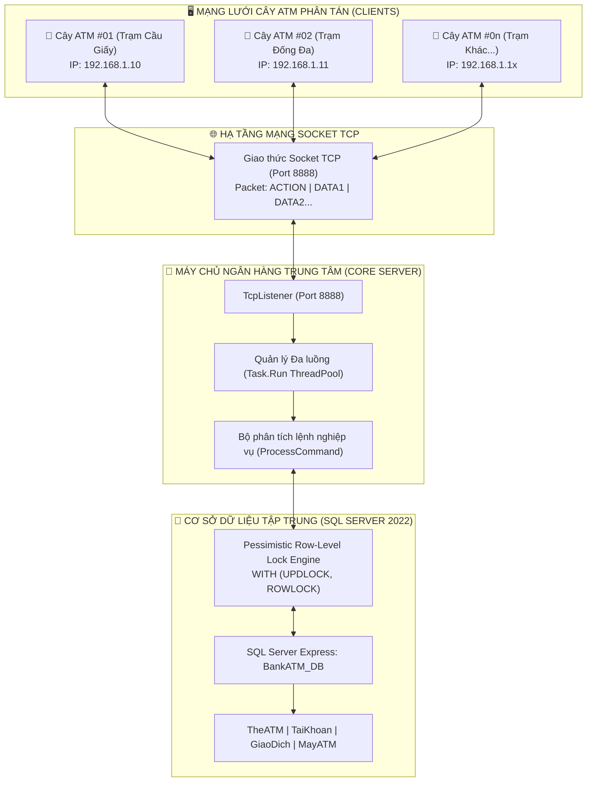

# 🏦 EPU CORE BANKING & DISTRIBUTED ATM NETWORK SYSTEM
### HỆ THỐNG GIAO DỊCH NGÂN HÀNG & MẠNG LƯỚI CÂY ATM PHÂN TÁN (EPU BANK)

<p align="center">
  
  
  
  
  
</p>

---

## 📖 1. GIỚI THIỆU ĐỀ TÀI

* **Học phần:** Lập trình .NET
* **Khoa:** Công nghệ Thông tin - **Trường Đại học Điện Lực (EPU)**
* **Lớp:** D19CNPM3
* **Đề tài:** Xây dựng Hệ thống Giao dịch Ngân hàng Lõi (Core Banking) và Mạng lưới Cây ATM Phân tán qua Giao thức Mạng Socket TCP.

Hệ thống mô phỏng trọn vẹn kiến trúc vận hành của một ngân hàng thương mại hiện đại:
* **Các cây ATM (Client Terminals):** Giao diện phần cứng ATM Kiosk thực tế (màn hình giao dịch cảm ứng, bàn phím số PinPad vật lý, khe cắm thẻ, khay nhả tiền mặt, in biên lai).
* **Máy chủ Ngân hàng Trung tâm (Core Banking Server):** Tiếp nhận kết nối đồng thời từ nhiều cây ATM qua giao thức TCP Socket đa luồng (Multithreaded Socket).
* **Cơ sở dữ liệu tập trung (Centralized SQL Database):** Quản lý khách hàng, tài khoản, thẻ ATM, hạn mức cây ATM và lịch sử giao dịch thời gian thực theo chuẩn toàn vẹn ACID.

---

## 👥 2. THÀNH VIÊN NHÓM THỰC HIỆN

| STT | Họ và Tên | Vai trò chính | Phân công nhiệm vụ cụ thể |
| :---: | :--- | :---: | :--- |
| **1** | **Lê Thị Thúy Hiền** *(Nhóm trưởng)* | **Team Leader & Database Architect** | • Thiết kế lược đồ CSDL chuẩn 3NF (`BankATM_DB`)<br>• Lập trình tầng nghiệp vụ `DatabaseHelper`<br>• Thiết kế giao dịch `SqlTransaction` & Khóa tranh chấp CSDL (`UPDLOCK, ROWLOCK`)<br>• Điều phối tiến độ & Quản lý mã nguồn GitHub |
| **2** | **Vũ Bình An** | **Frontend ATM Client Developer** | • Thiết kế giao diện ATM Kiosk Bezel & Bàn phím số PinPad (`Form1`)<br>• Xây dựng hệ thống UserControl giao dịch (`UcScreenLogin`, `UcScreenMenu`, `UcScreenWithdraw`, `UcScreenTransfer`, `UcScreenHistory`, `UcScreenChangePin`)<br>• Tích hợp module In biên lai & Xuất hóa đơn Notepad |
| **3** | **Nguyễn Minh Đức** | **Backend Core Server Developer** | • Lập trình máy chủ `Bank.Server` trên nền tảng `TcpListener`<br>• Xử lý kết nối Đa luồng bất đồng bộ (`Task.Run` / Multithreading)<br>• Định nghĩa giao thức truyền tin Socket TCP độc quyền<br>• Viết kịch bản kiểm thử tải đồng thời (Concurrency Testing) |

---

## 🏗️ 3. KIẾN TRÚC HỆ THỐNG (SYSTEM ARCHITECTURE)

Hệ thống hoạt động theo mô hình **Client - Server Phân tán (Distributed Client-Server Model)**:



---

## ⚡ 4. TRỌNG TÂM KỸ THUẬT & ĐIỂM SÁNG ĐỒ ÁN

### 🎯 4.1. Bài toán Đa luồng (Multithreading) & Khóa tranh chấp (Concurrency Lock)
* **Vấn đề thực tiễn:** Khách hàng sở hữu tài khoản có 1.000.000 VNĐ. Nếu khách hàng thực hiện rút 1.000.000 VNĐ tại 2 cây ATM khác nhau tại **cùng 1 mili-giây**, hệ thống có bị rút lố thành 2.000.000 VNĐ và tài khoản bị âm tiền hay không?
* **Giải pháp của nhóm:**
  1. **Đa luồng Socket:** Mỗi cây ATM kết nối vào Server được đẩy vào một luồng độc lập qua `Task.Run(() => HandleATMClient(client))` trong ThreadPool của .NET, bảo đảm phục vụ hàng chục cây ATM cùng lúc mà không bị treo Server.
  2. **Khóa cấp độ dòng CSDL (Pessimistic Row-Level Lock):**
     ```sql
     SELECT SoDu, TrangThai FROM TaiKhoan WITH (UPDLOCK, ROWLOCK) WHERE SoTaiKhoan = @soTK
     ```
     * `ROWLOCK`: Chỉ khóa duy nhất bản ghi (Record) của tài khoản đang thao tác, các tài khoản khác giao dịch song song 100% với độ trễ 0ms.
     * `UPDLOCK`: Giữ cờ khóa cập nhật ngay từ lúc kiểm tra số dư, buộc giao dịch thứ 2 phải chờ giao dịch thứ nhất `COMMIT` hoặc `ROLLBACK`.
     * **Triệt tiêu Deadlock:** Sắp xếp tài khoản theo thứ tự chuỗi trước khi khóa dòng khi thực hiện chuyển tiền liên tài khoản.

### 🛡️ 4.2. Cơ chế An toàn & Bảo mật (Security)
* **Chống tấn công vét cạn (Brute-Force PIN Lock):** Quản lý trường `SoLanSaiPIN` trong bảng `TheATM`. Nếu nhập sai mã PIN 3 lần liên tiếp, hệ thống tự động khóa thẻ ngay lập tức (`IsLocked = 1`) và phát cảnh báo trên màn hình ATM.
* **Giao diện bảo mật chuẩn UX:** Hỗ trợ con mắt ẩn/hiện mã PIN nhúng trực tiếp bên trong viền của ô nhập (`👁` / `🙈`), bàn phím số xáo trộn vị trí hoặc nhập số bảo mật qua phần cứng.

---

## 💻 5. CÁC TÍNH NĂNG CHÍNH CỦA HỆ THỐNG

| Tính năng | Mô tả chi tiết |
| :--- | :--- |
| **1. Xác thực & Đăng nhập Thẻ** | Nhập số thẻ và mã PIN 6 số. Kiểm tra trạng thái thẻ bị khóa, tự động phát hiện số lần sai PIN. |
| **2. Rút tiền mặt ATM** | Chọn nhanh các mệnh giá phổ biến (100k, 200k, 500k, 1M, 2M) hoặc tùy chọn nhập số tiền lẻ theo bội số. Đồng bộ số dư tức thì. |
| **3. Chuyển khoản 24/7** | Nhập số tài khoản thụ hưởng $\rightarrow$ Tự động truy vấn và hiển thị Họ tên người nhận $\rightarrow$ Nhập số tiền & nội dung $\rightarrow$ Trừ tiền người gửi, cộng tiền người nhận trong 1 Transaction duy nhất. |
| **4. Truy vấn Lịch sử Giao dịch** | Hiển thị 5 giao dịch gần nhất thời gian thực từ CSDL. Phân biệt màu sắc dòng tiền thông minh (`+` Xanh lá cho tiền nhận, `-` Đỏ cho tiền rút/chuyển). |
| **5. Đổi mã PIN bảo mật** | Nhập mã PIN cũ, mã PIN mới (6 số), xác nhận mã PIN mới. Kiểm tra trùng khớp và cập nhật trực tiếp vào SQL Server. |
| **6. In biên lai / Sao kê** | Hộp thoại biên lai điện tử hiển thị chi tiết số hóa đơn, ngày giờ, số thẻ che bảo mật (`9704****1001`), đồng thời tự động xuất ra file bản cứng Notepad (`BienLai_ATM_*.txt`). |

---

## 🗂️ 6. CẤU TRÚC THƯ MỤC DỰ ÁN

```text
EPU_BankSystem/
│
├── Bank.Client/                      # [FRONTEND] Ứng dụng mô phỏng Kiosk Cây ATM (WinForms)
│   ├── Screens/                      # Bộ các màn hình UserControl chuyển đổi mượt mà
│   │   ├── UcScreenLogin.cs          # Màn hình Đăng nhập thẻ & PIN (Con mắt ẩn/hiện)
│   │   ├── UcScreenMenu.cs           # Màn hình Menu lựa chọn 5 dịch vụ chính
│   │   ├── UcScreenWithdraw.cs       # Màn hình Rút tiền mặt (Mệnh giá nhanh & Tùy chọn)
│   │   ├── UcScreenTransfer.cs       # Màn hình Chuyển khoản liên tài khoản 24/7
│   │   ├── UcScreenHistory.cs        # Màn hình Lịch sử 5 giao dịch gần nhất
│   │   ├── UcScreenChangePin.cs      # Màn hình Đổi mã PIN bảo mật
│   │   └── AtmSession.cs             # Quản lý phiên làm việc tạm thời của chủ thẻ
│   ├── AtmClientSocket.cs            # Lớp chuyên trách gửi/nhận gói tin Socket TCP
│   ├── Form1.cs                      # Khung Kiosk ATM vật lý & Bàn phím số PinPad
│   └── FormReceipt.cs                # Hộp thoại hiển thị và in hóa đơn biên lai
│
├── Bank.Server/                      # [BACKEND] Máy chủ Ngân hàng Lõi Core Banking
│   └── Program.cs                    # TcpListener lắng nghe Port 8888, Đa luồng Task.Run
│
├── Bank.Common/                      # [SHARED CORE] Thư viện nghiệp vụ & Kết nối CSDL
│   ├── DatabaseHelper.cs             # Kết nối SQL Server, SqlTransaction, Row-level Lock
│   └── TransactionDTO.cs             # Lớp đối tượng truyền tải dữ liệu (Data Transfer Object)
│
├── Database/                         # [DATABASE] Kịch bản Cơ sở dữ liệu
│   └── BankATM_DB.sql                # File script tạo 8 bảng quan hệ, ràng buộc và dữ liệu mẫu
│
├── Docs/                             # [DOCUMENTS] Tài liệu đồ án, báo cáo chuẩn EPU
├── EPU_BankSystem.slnx               # File Solution chính (.NET 10 / Visual Studio 2022)
├── .gitignore                        # Cấu hình bỏ qua file tạm build (.vs, bin, obj)
├── .gitattributes                    # Chuẩn hóa ngắt dòng Git
└── README.md                         # Tài liệu hướng dẫn chính của dự án
```

---

## 🚀 7. HƯỚNG DẪN CÀI ĐẶT & CHẠY THỬ NGHIỆM (QUICK START)

### 📌 Yêu cầu môi trường:
* Hệ điều hành: Windows 10 / Windows 11
* IDE: **Visual Studio 2022** (đã cài gói *.NET desktop development*)
* SDK: **.NET 10.0** (hoặc .NET 8.0 trở lên)
* CSDL: **Microsoft SQL Server 2022** (bản Developer hoặc SQL Express) + SSMS

---

### ⚙️ Các bước thực hiện:

#### Bước 1: Khởi tạo Cơ sở Dữ liệu
1. Mở phần mềm **SQL Server Management Studio (SSMS)**.
2. Mở file [Database/BankATM_DB.sql](Database/BankATM_DB.sql).
3. Nhấn **Execute (F5)** để tạo CSDL `BankATM_DB` và nạp toàn bộ dữ liệu tài khoản mẫu.

#### Bước 2: Khởi động Core Banking Server
1. Mở Solution `EPU_BankSystem.slnx` bằng Visual Studio 2022.
2. Chuột phải vào project **`Bank.Server`** $\rightarrow$ chọn **Set as Startup Project**.
3. Nhấn **F5** (hoặc `Ctrl + F5`) để chạy Server. Cửa sổ Console màu đen sẽ hiện thông báo:
   ```text
   ====================================================================
      HE THONG NGAN HANG DIEN LUC (EPU BANK) - CORE SERVER V2.4
      [SERVER] Dang lang nghe ket noi tren cong: 8888
      [TRANG THAI] San sang tiep nhan cac cay ATM truc tuyen...
   ====================================================================
   ```

#### Bước 3: Khởi động Cây ATM (Client)
1. Trong Visual Studio, chuột phải vào project **`Bank.Client`** $\rightarrow$ chọn **Debug $\rightarrow$ Start New Instance** (hoặc mở trực tiếp file `Bank.Client.exe` trong thư mục `bin\Debug`).
2. Có thể mở **2 hoặc nhiều cửa sổ `Bank.Client.exe`** cùng lúc để mô phỏng mạng lưới nhiều cây ATM cùng hoạt động!

---

## 💳 8. DỮ LIỆU TÀI KHOẢN & THẺ TEST CÓ SẴN

| Số Thẻ ATM | Mã PIN | Số Tài Khoản | Chủ Thẻ | Số Dư Ban Đầu | Trạng Thái Thẻ |
| :---: | :---: | :---: | :--- | :---: | :---: |
| **`9704000000001001`** | **`123456`** | **`1001`** | Nguyễn Văn An | **8.500.000 VNĐ** | ✅ Hoạt động bình thường |
| **`9704000000001002`** | **`654321`** | **`1002`** | Trần Thị Bình | **15.200.000 VNĐ** | ✅ Hoạt động bình thường |
| **`9704000000001003`** | `111111` | `1003` | Lê Minh Cường | 250.000 VNĐ | ❌ Đã bị khóa do sai PIN |

---

## 📄 9. BẢN QUYỀN & LỜI CẢM ƠN

Đồ án được thực hiện phục vụ mục đích học tập và nghiên cứu trong khuôn khổ môn học tại **Trường Đại học Điện Lực (EPU)**.
* Nhóm xin trân trọng gửi lời cảm ơn sâu sắc tới các Thầy/Cô bộ môn Khoa Công nghệ Thông tin đã tận tình hướng dẫn và định hướng kỹ thuật cho nhóm hoàn thành đồ án này!

<p align="center">
  <b>© 2026 EPU Banking System Project. Developed by Class D19CNPM3.</b>
</p>
