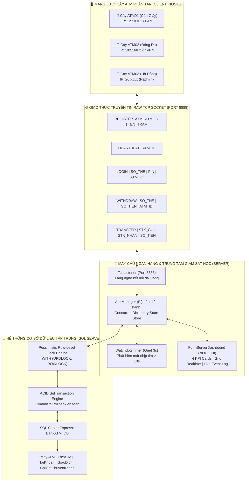

# 🏦 EPU CORE BANKING & DISTRIBUTED ATM NETWORK SYSTEM
### HỆ THỐNG GIAO DỊCH NGÂN HÀNG LÕI & TRUNG TÂM GIÁM SÁT MẠNG LƯỚI CÂY ATM PHÂN TÁN (EPU BANK NOC)

<p align="center">
  
  
  
  
  
  
</p>

---

## 📖 1. GIỚI THIỆU ĐỀ TÀI

* **Học phần:** Lập trình .NET / Lập trình Mạng & Xử lý Đa luồng
* **Khoa:** Công nghệ Thông tin - **Trường Đại học Điện Lực (EPU)**
* **Lớp:** D19CNPM3
* **Đề tài:** Xây dựng Hệ thống Giao dịch Ngân hàng Lõi (Core Banking) và Trung tâm Giám sát Mạng lưới Cây ATM Phân tán (ATM NOC Monitoring) qua Giao thức Mạng TCP Socket thuần.

### 🌟 Điểm mới & Tính thực tiễn của Đề tài:
1. **Kiến trúc Mạng Socket TCP thuần:** Sử dụng Raw TCP Socket (`TcpListener` / `TcpClient`) cổng `8888` thay vì các Web API / HTTP Framework trung gian, phản ánh đúng giao thức truyền tin viễn thông tài chính (ISO 8583) trong hệ thống liên ngân hàng thực tế.
2. **Quản lý Mạng lưới Phân tán & Nhịp tim (Heartbeat):** Các cây ATM gửi tín hiệu nhịp tim định kỳ 4s. Bộ quét Watchdog 3s tại Server tự động phát hiện mất kết nối sau 10s và hỗ trợ **tự động kết nối lại (Auto-reconnect / Self-healing)** khi mạng phục hồi.
3. **Trung tâm Điều hành Mạng lưới (Central Monitoring NOC Dashboard):** Giao diện WinForms hiện đại hiển thị thời gian thực tình trạng trạm, địa chỉ IP, nhịp tim theo giây, quỹ tiền mặt trong khay, tổng lệnh giao dịch và Live Event Log.
4. **Giải quyết bài toán Tranh chấp Đa luồng (Concurrency & Locking):** Áp dụng cơ chế **Database Row-Level Lock (`WITH (UPDLOCK, ROWLOCK)`)** kết hợp `SqlTransaction` tuân thủ nguyên lý ACID, triệt tiêu 100% hiện tượng **Race Condition** và lỗi rút lố số dư (Double-spending) mà không làm nghẽn các giao dịch của khách hàng khác.

---

## 👥 2. PHÂN CÔNG NHIỆM VỤ THÀNH VIÊN (TASK ASSIGNMENT)

| STT | Thành viên | Vai trò chính | Giao diện phụ trách | Trọng tâm kỹ thuật & Nhiệm vụ đảm nhiệm |
| :---: | :--- | :---: | :--- | :--- |
| **1** | **Lê Thị Thúy Hiền**<br>*(Nhóm trưởng)* | **Team Leader & Core Architecture<br>(Database & Socket Architect)** | 1. **`FormServerDashboard`** *(NOC Server)*<br>2. **`Form1`** *(Khung Kiosk ATM)*<br>3. **`UcScreenLogin`** *(Đăng nhập Thẻ & PIN)* | • **Lập trình Mạng Socket TCP thuần (`Bank.Server\Program.cs` & `AtmClientSocket.cs`):** Lắng nghe cổng 8888, xử lý kết nối đa luồng bất đồng bộ (`Task.Run` ThreadPool), xây dựng bộ giải mã gói tin `ProcessCommand`.<br>• **Bộ não Quản lý Trạm (`AtmManager.cs`):** Cơ chế nhịp tim **Heartbeat 4s & Watchdog 10s qua Socket**, tự động phục hồi kết nối (Auto-reconnect).<br>• **Cơ sở Dữ liệu & Tầng Nghiệp vụ (`BankATM_DB.sql` & `DatabaseHelper.cs`):** Thiết kế 8 bảng chuẩn 3NF, xử lý đăng nhập, tự động khóa thẻ sau 3 lần sai PIN.<br>• **Khóa Concurrency CSDL:** Áp dụng `WITH (UPDLOCK, ROWLOCK)` và `SqlTransaction` chống rút lố tiền (Race Condition).<br>• Điều phối tiến độ, quản lý mã nguồn GitHub và chuẩn bị kịch bản bảo vệ đồ án. |
| **2** | **Nguyễn Minh Đức** | **Core Transactions & Business Logic Developer** | 1. **`UcScreenMenu`** *(Menu tính năng & Số dư)*<br>2. **`UcScreenWithdraw`** *(Rút tiền mặt)*<br>3. **`UcScreenTransfer`** *(Chuyển khoản 24/7)* | • **Nghiệp vụ Rút tiền ATM (`UcScreenWithdraw`):** Xây dựng các nút mệnh giá nhanh (100k - 5M) và ô nhập tiền lẻ tùy chọn, kiểm tra bội số tiền mặt, trừ tiền tài khoản & trừ quỹ tiền mặt khay máy.<br>• **Nghiệp vụ Chuyển khoản 24/7 (`UcScreenTransfer`):** Tự động tra cứu và hiển thị tên người thụ hưởng theo số tài khoản, kiểm tra tính hợp lệ và xác nhận chuyển tiền.<br>• **Màn hình Menu (`UcScreenMenu`):** Hiển thị lời chào, số dư khả dụng và điều hướng nghiệp vụ.<br>• **Kiểm thử Đa máy (Multi-device Testing):** Phối hợp cùng Hiền chạy thực nghiệm máy khách kết nối qua Socket (LAN / Radmin VPN) kiểm tra tải đồng thời. |
| **3** | **Vũ Bình An** | **Account Management & Reporting / UI-UX Developer** | 1. **`UcScreenHistory`** *(Lịch sử giao dịch)*<br>2. **`UcScreenChangePin`** *(Đổi mã PIN thẻ)*<br>3. **`FormReceipt`** *(In biên lai sao kê nhiệt)* | • **Quản trị Lịch sử Giao dịch (`UcScreenHistory`):** Truy vấn và hiển thị 5 giao dịch gần nhất từ CSDL, phân loại màu sắc dòng tiền trực quan (`+` màu xanh tiền vào, `-` màu đỏ tiền ra).<br>• **Nghiệp vụ Đổi mã PIN (`UcScreenChangePin`):** Xác thực mã PIN cũ, kiểm tra ràng buộc 6 số, xác nhận khớp mã PIN mới.<br>• **Module In Biên lai Nhiệt (`FormReceipt.cs`):** Thiết kế giao diện giấy in nhiệt ATM, sinh mã giao dịch `TXN`, mã vạch Barcode và hàm xuất file `.txt` tự động mở bằng Notepad.<br>• **Chuẩn hóa Đa màn hình (`DpiUnaware`):** Tối ưu cấu hình hiển thị, đảm bảo giao diện sắc nét, chuẩn 100% không bị vỡ font giữa các máy tính. |

---

## 🏗️ 3. KIẾN TRÚC HỆ THỐNG (SYSTEM ARCHITECTURE)

Hệ thống hoạt động theo mô hình **Client - Server Phân tán Đa luồng (Distributed Multi-threaded Architecture)**:



---

## ⚡ 4. TRỌNG TÂM KỸ THUẬT: CƠ CHẾ KHÓA & AN NINH HỆ THỐNG

### 🎯 4.1. Giải đáp bài toán Vấn đáp: "Chọn Lock ở tầng nào? Vì sao không để 1 giao dịch bị lock ảnh hưởng giao dịch khác?"

* **Vấn đề thực tiễn:** Khách hàng sở hữu tài khoản có 1.000.000 VNĐ. Nếu dùng 2 thẻ cùng bấm rút 1.000.000 VNĐ tại 2 cây ATM khác nhau ở **cùng 1 mili-giây**, hệ thống có bị lỗi rút lố thành 2.000.000 VNĐ (Race Condition / Double-spending) hay không?
* **Lựa chọn kiến trúc của nhóm: Database Row-Level Lock (`WITH (UPDLOCK, ROWLOCK)`):**
  
  ```sql
  -- Khóa đúng 1 dòng dữ liệu của tài khoản thực hiện giao dịch:
  SELECT SoDu, TrangThai FROM TaiKhoan WITH (UPDLOCK, ROWLOCK) WHERE SoTaiKhoan = @soTK
  ```

| Tiêu chí phân tích | Application-Level Lock (`lock(obj)` / `synchronized`) | Table-Level Lock (`WITH (TABLOCKX)`) | Row-Level Lock của Nhóm (`ROWLOCK, UPDLOCK`) |
| :--- | :--- | :--- | :--- |
| **Vị trí khóa** | Tầng ứng dụng Server (RAM C#) | Tầng bảng CSDL (SQL Server) | **Tầng dòng bản ghi CSDL (SQL Server)** |
| **Phạm vi khóa** | Toàn bộ các luồng giao dịch | Khóa toàn bộ bảng `TaiKhoan` | **Chỉ khóa duy nhất 1 dòng tài khoản đang rút/chuyển** |
| **Ảnh hưởng giao dịch khác?** | ❌ **Gây nghẽn nặng:** Khách A rút tiền TK `1001` làm khách B rút TK `1002` phải đứng chờ! | ❌ **Gây sập hiệu năng:** Mọi tài khoản khác đều bị đứng chờ bảng mở khóa. | ✅ **Hoàn toàn độc lập:** Khách B ở ATM khác giao dịch trên TK `1002` chạy song song 100% không bị delay 1ms! |
| **Khả năng mở rộng (Scale-out)** | ❌ Vô dụng nếu chạy nhiều Server cụm (Cluster). | ⚠️ Rất kém khi lưu lượng giao dịch tăng cao. | ✅ Hoạt động an toàn trên mọi cụm máy chủ và vi dịch vụ. |
| **Chống Double-Spending** | Có (nhưng gây nghẽn toàn cục) | Có (nhưng khóa quá mức) | ✅ **Tuyệt đối an toàn, giữ tính trọn vẹn ACID.** |

### 🛡️ 4.2. Các cơ chế An toàn & Bảo mật (Security) đã hiện thực
1. **Chống SQL Injection 100%:** Toàn bộ truy vấn đều dùng `SqlCommand.Parameters.AddWithValue()`. Kẻ tấn công nhập `' OR 1=1 --` hoàn toàn vô hại.
2. **Toàn vẹn giao dịch ACID:** Toàn bộ chuỗi nghiệp vụ tài chính được đóng gói trong `SqlTransaction`. Bất kỳ sự cố mạng hoặc lỗi ngoại lệ nào đều được `trans.Rollback()`, không xảy ra tình trạng "bên gửi bị trừ tiền mà bên nhận chưa được cộng".
3. **Chống dò quét mã PIN (Anti Brute-Force):** Tự động theo dõi cột `SoLanSaiPIN` trong bảng `TheATM`. Nếu nhập sai liên tiếp 3 lần, thẻ bị tự động khóa vĩnh viễn (`IsLocked = 1`) và từ chối mọi phiên giao dịch tiếp theo.
4. **Khóa bảo vệ trạm từ xa (ATM Maintenance Lockout):** Khi Trung tâm NOC kích hoạt chế độ "Bảo trì", cây ATM tại hiện trường sẽ tự động hiển thị trạng thái bảo trì và từ chối mọi thao tác đăng nhập/rút tiền của khách hàng.
5. **Đồng bộ hiển thị chuẩn đa màn hình (`DpiUnaware`):** Cấu hình `<ApplicationHighDpiMode>DpiUnaware</ApplicationHighDpiMode>` giúp giao diện cố định 100%, không bị Windows tự ý phóng to làm tràn chữ hay lệch nút bấm giữa các máy tính có tỉ lệ scale khác nhau.

---

## 💻 5. CÁC PHÂN HỆ VÀ GIAO DIỆN HỆ THỐNG

Dự án bao gồm tổng cộng **9 giao diện chính thức** và **3 hộp thoại chức năng (Modal Popups)**, được phân chia cụ thể theo từng thành viên:

### 👑 Phân hệ do Bạn Hiền phụ trách:
1. **`FormServerDashboard` (Trung tâm Giám sát Mạng lưới ATM NOC):**
   * 4 thẻ KPI thống kê số lượng trạm: Tổng trạm, Đang hoạt động (Online), Mất kết nối (Offline), Đang bảo trì.
   * Bảng giám sát chi tiết từng cây ATM: Mã ATM, Tên trạm, Vị trí, Địa chỉ IP:Port, Nhịp tim theo giây (`Vừa xong...`, `4s trước`), Quỹ tiền mặt trong khay máy, Tổng số lệnh giao dịch đã phục vụ.
   * Cửa sổ **Live Network Event Log** ghi nhận thời gian thực mọi sự kiện kết nối, ngắt mạng, tự phục hồi, tiếp quỹ và giao dịch.
   * **3 Hộp thoại điều khiển tích hợp:**
     * *Đặt chế độ Bảo trì*: Chọn cây ATM cần khóa bảo dưỡng kỹ thuật.
     * *Kích hoạt Hoạt động (Online)*: Mở lại cây ATM phục vụ khách hàng.
     * *Nạp quỹ tiền mặt*: Chọn cây ATM và mệnh giá nạp vào khay máy (+20M, +50M, +100M, +200M).
2. **`Form1` (Vỏ máy ATM Kiosk vật lý):** Thanh định danh trạm (`ATM01`, `ATM02`, `ATM03`), cấu hình Server IP/Port, huy hiệu trạng thái kết nối nhịp tim, bàn phím số phần cứng (**PinPad** 0-9, CLEAR, ENTER), khe cắm thẻ (**Card Slot**), khe nhả tiền (**Cash Tray**).
3. **`UcScreenLogin` (Màn hình Đăng nhập Thẻ & PIN):** Nhập số thẻ, mã PIN 6 số với nút mắt ẩn/hiện mật khẩu, tự động khóa thẻ sau 3 lần sai và từ chối khi trạm đang bảo trì.

### 💼 Phân hệ do Bạn Đức phụ trách:
4. **`UcScreenMenu` (Màn hình Menu tính năng chính & Số dư):** Hiển thị lời chào chủ thẻ, số dư tài khoản khả dụng và các nút điều hướng nghiệp vụ.
5. **`UcScreenWithdraw` (Màn hình Rút tiền mặt):** 6 nút chọn mệnh giá nhanh (100k, 200k, 500k, 1M, 2M, 5M) hoặc ô nhập tiền lẻ tùy chọn; đồng thời trừ tiền tài khoản và trừ quỹ tiền mặt vật lý tại cây ATM.
6. **`UcScreenTransfer` (Màn hình Chuyển khoản):** Nhập số tài khoản nhận, tự động tra cứu hiển thị tên người nhận, nhập số tiền và nội dung chuyển tiền 24/7.

### 🎨 Phân hệ do Bạn An phụ trách:
7. **`UcScreenHistory` (Màn hình Truy vấn Lịch sử giao dịch):** Bảng hiển thị 5 giao dịch biến động số dư gần nhất kèm thời gian và loại giao dịch (nhận tiền, rút tiền, chuyển tiền).
8. **`UcScreenChangePin` (Màn hình Đổi mã PIN thẻ):** Xác thực mã PIN cũ, nhập mã PIN mới và xác nhận lại mã PIN mới.
9. **`FormReceipt` (Màn hình In & Xuất biên lai in nhiệt):** Mô phỏng giấy in nhiệt máy ATM ngoài đời thực với thông tin số hóa đơn, ngày giờ, số thẻ che bảo mật, mã vạch Barcode và nút **In ra file Text Notepad**.

---

## 🗂️ 6. CẤU TRÚC THƯ MỤC DỰ ÁN

```text
EPU_BankSystem/
│
├── Bank.Client/                           # [FRONTEND] Ứng dụng Máy ATM Kiosk vật lý (WinForms)
│   ├── Screens/                           # Các màn hình UserControl giao dịch ngân hàng
│   │   ├── UcScreenLogin.cs               # Màn hình Đăng nhập thẻ & PIN bảo mật
│   │   ├── UcScreenMenu.cs                # Màn hình Menu chính & Hiển thị số dư
│   │   ├── UcScreenWithdraw.cs            # Màn hình Rút tiền mặt (Mệnh giá nhanh & Tùy chọn)
│   │   ├── UcScreenTransfer.cs            # Màn hình Chuyển khoản liên tài khoản 24/7
│   │   ├── UcScreenHistory.cs             # Màn hình Lịch sử 5 giao dịch gần nhất
│   │   ├── UcScreenChangePin.cs           # Màn hình Đổi mã PIN thẻ ATM
│   │   └── AtmSession.cs                  # Lưu trữ phiên làm việc tạm thời của máy ATM
│   ├── AtmClientSocket.cs                 # Gửi/nhận gói tin TCP Socket & Heartbeat định kỳ 4s
│   ├── Form1.cs & Form1.Designer.cs       # Khung Kiosk ATM Bezel, PinPad & Bộ chọn trạm ATM
│   ├── FormReceipt.cs                     # Cửa sổ hiển thị hóa đơn in nhiệt & Xuất file Notepad
│   ├── Program.cs                         # Điểm khởi chạy ứng dụng Client
│   └── Bank.Client.csproj                 # Cấu hình dự án (Khóa DPI Unaware chuẩn màn hình)
│
├── Bank.Server/                           # [BACKEND] Máy chủ Core Banking & Giám sát NOC
│   ├── AtmManager.cs                      # Quản lý trạng thái trạm, Heartbeat & Watchdog ngắt mạng
│   ├── FormServerDashboard.cs             # Màn hình Trung tâm Giám sát Mạng lưới ATM NOC
│   ├── FormServerDashboard.Designer.cs    # Thiết kế giao diện Dashboard, KPI Cards & Event Log
│   ├── Program.cs                         # Khởi động Socket TCP Port 8888 đa luồng & Chạy NOC UI
│   └── Bank.Server.csproj                 # Cấu hình dự án (WinExe Windows Forms)
│
├── Bank.Common/                           # [SHARED CORE] Thư viện nghiệp vụ & Tầng kết nối CSDL
│   ├── DatabaseHelper.cs                  # Kết nối SQL Server, SqlTransaction, Row-level Lock
│   ├── AccountDTO.cs                      # DTO truyền tải thông tin tài khoản người dùng
│   ├── AtmTerminalDTO.cs                  # DTO trạng thái trạm ATM, nhịp tim, quỹ tiền mặt
│   └── TransactionDTO.cs                  # DTO thông tin lịch sử giao dịch ngân hàng
│
├── Database/                              # [DATABASE SCRIPT]
│   └── BankATM_DB.sql                     # Kịch bản tạo CSDL, ràng buộc quan hệ & Dữ liệu mẫu
│
├── Docs/                                  # Tài liệu báo cáo đồ án
├── EPU_BankSystem.slnx                    # File Solution giải pháp Visual Studio 2022
├── .gitignore                             # Cấu hình bỏ qua file tạm build (.vs, bin, obj)
└── README.md                              # Tài liệu hướng dẫn chính của đồ án
```

---

## 🚀 7. HƯỚNG DẪN CÀI ĐẶT & CHẠY THỬ NGHIỆM (QUICK START)

### 📌 Yêu cầu môi trường:
* **Hệ điều hành:** Windows 10 / Windows 11
* **IDE:** **Visual Studio 2022** (Gói *.NET desktop development*)
* **SDK:** **.NET 10.0** (hoặc .NET 8.0 trở lên)
* **Cơ sở dữ liệu:** **Microsoft SQL Server 2022** (bản SQL Express `localhost\SQLEXPRESS`)

---

### ⚙️ Các bước triển khai thực tế:

#### Bước 1: Khởi tạo Cơ sở Dữ liệu SQL Server
1. Mở **SQL Server Management Studio (SSMS)** hoặc công cụ **SQL Server Object Explorer** trong Visual Studio.
2. Kết nối vào máy chủ `localhost\SQLEXPRESS` bằng chế độ **Windows Authentication** *(tích chọn `Trust Server Certificate`)*.
3. Mở file [Database/BankATM_DB.sql](Database/BankATM_DB.sql) và nhấn **Execute (F5)** để tạo CSDL `BankATM_DB`.

#### Bước 2: Khởi động Core Banking Server (Máy 1)
1. Mở file `EPU_BankSystem.slnx` trên Visual Studio.
2. Chuột phải vào project **`Bank.Server`** $\rightarrow$ chọn **Set as Startup Project**.
3. Nhấn **F5** để khởi chạy Server:
   * Giao diện **EPU BANK NOC - TRUNG TÂM GIÁM SÁT MẠNG LƯỚI ATM** hiện lên.
   * Server tự động lắng nghe cổng TCP `8888` và tải dữ liệu 3 cây ATM vào bảng giám sát.

#### Bước 3: Khởi động Cây ATM Client (Cùng máy hoặc Máy tính khác)
* **Chạy trên cùng máy:** Chuột phải vào project **`Bank.Client`** $\rightarrow$ chọn **Debug $\rightarrow$ Start New Instance**. Có thể mở nhiều cửa sổ cùng lúc (ví dụ cửa sổ 1 chọn `ATM01`, cửa sổ 2 chọn `ATM02`).
* **Chạy giữa 2 máy tính khác nhau qua mạng LAN / Wi-Fi / Radmin VPN:**
  1. Máy 1 (chạy Server) lấy địa chỉ IP bằng lệnh `ipconfig` (hoặc IP phòng Radmin VPN, ví dụ: `26.221.124.171`).
  2. Máy 2 (mở cây `ATM03`): Tại thanh cấu hình trên đỉnh màn hình Kiosk, nhập đúng IP của Máy 1 và Port `8888`.
  3. Huy hiệu góc phải cây ATM lập tức đổi sang màu xanh **`STATUS: CONNECTED`**, và trên Dashboard máy 1 sẽ nhảy thông báo phục hồi:
     > `[SUCCESS] [TỰ PHỤC HỒI] Cây ATM03 (ATM Chi nhánh Hà Đông) đã kết nối lại và hoạt động bình thường!`

---

## 💳 8. DỮ LIỆU TÀI KHOẢN & THẺ TEST DEMO

| Số Thẻ ATM | Mã PIN | Số Tài Khoản | Chủ Tài Khoản | Số Dư Mẫu | Ghi chú Trạng thái |
| :---: | :---: | :---: | :--- | :---: | :--- |
| **`9704000000001001`** | **`123456`** | **`1001`** | Nguyễn Văn An | **8.500.000 VNĐ** | ✅ Hoạt động bình thường |
| **`9704000000001002`** | **`654321`** | **`1002`** | Trần Thị Bình | **15.200.000 VNĐ** | ✅ Hoạt động bình thường |
| **`9704000000001003`** | `111111` | `1003` | Lê Minh Cường | 250.000 VNĐ | ❌ Thẻ bị khóa do nhập sai PIN 3 lần |

* **Danh sách Trạm ATM mô phỏng:**
  * **`ATM01`**: ATM ĐH Điện Lực (EPU) - 235 Hoàng Quốc Việt, Cầu Giấy, Hà Nội
  * **`ATM02`**: ATM Chi nhánh Đống Đa - 100 Tây Sơn, Đống Đa, Hà Nội
  * **`ATM03`**: ATM Chi nhánh Hà Đông - 10 Trần Phú, Hà Đông, Hà Nội

---

## 🎬 9. KỊCH BẢN THUYẾT TRÌNH BẢO VỆ ĐỒ ÁN (DEMO SCENARIOS)

Khi đứng trước Hội đồng chấm thi, nhóm thực hiện 6 bước demo sau để đạt điểm tuyệt đối:

1. **Demo Kiến trúc Phân tán:** Mở Server NOC trên Máy 1, mở ATM01 trên Máy 1 và ATM03 trên Máy 2 $\rightarrow$ Server NOC hiển thị `2 ONLINE` kèm địa chỉ IP thực tế của 2 máy.
2. **Demo Nhịp tim & Tự phục hồi:** Tắt máy ATM03 $\rightarrow$ Sau đúng 10s, Server Watchdog phát hiện và chuyển ATM03 sang 🔴 `Mất kết nối`. Bật lại ATM03 $\rightarrow$ Server tự động phục hồi về 🟢 `Hoạt động`.
3. **Demo Quản trị NOC từ xa:** Trên Server, bấm nút *"Đặt Chế độ Bảo trì"* cho ATM01 $\rightarrow$ Cây ATM01 đổi đèn cam `STATUS: BẢO TRÌ` và chặn đứng giao dịch của khách hàng.
4. **Demo Nạp quỹ tiền mặt:** Bấm nút *"Nạp quỹ tiền mặt (+50 Triệu)"* vào khay máy ATM01 $\rightarrow$ Số dư cột Quỹ Tiền Mặt nhảy tăng ngay tức thì và ghi Live Event Log.
5. **Demo Cơ chế Khóa dòng (Row-Level Lock) & Đa luồng:** 2 máy ATM cùng lúc rút tiền trên 2 tài khoản khác nhau $\rightarrow$ Cả 2 giao dịch hoàn tất song song mà không bị nghẽn (0ms delay).
6. **Demo An ninh Khóa thẻ:** Nhập sai mã PIN 3 lần liên tiếp tại ATM $\rightarrow$ Hệ thống lập tức khóa thẻ vĩnh viễn (`IsLocked = 1`) trong CSDL.

---

## 📄 10. BẢN QUYỀN & LỜI CẢM ƠN

Đồ án được nghiên cứu và phát triển trong khuôn khổ môn học tại **Trường Đại học Điện Lực (EPU)**.
* Nhóm xin gửi lời cảm ơn chân thành tới các Thầy/Cô Bộ môn Khoa Công nghệ Thông tin đã tận tình giảng dạy, góp ý và định hướng kỹ thuật cho nhóm hoàn thành xuất sắc đề tài này!

<p align="center">
  <b>© 2026 EPU Banking System Project. Developed with pride by Class D19CNPM3.</b>
</p>
